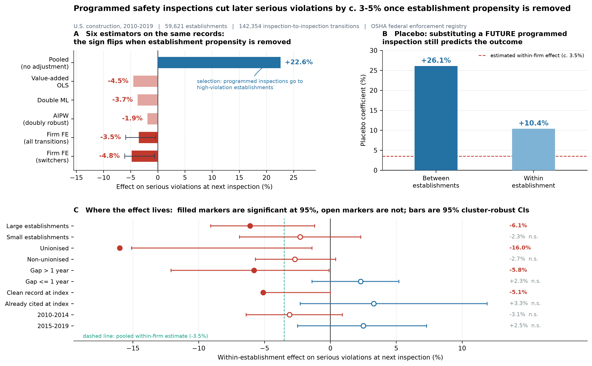

# Safety Inspection Causal Inference — real-data evaluation

**How large is the deterrent effect of safety inspections?**
Within-establishment evidence from 59,621 U.S. construction establishments (2010–2019).

Replication code and results for the *Safety Science* submission.

> **Repo URL:** https://github.com/BoHaiGIT/safety-inspection-causal
>
> Cited in the manuscript (Data & Code Availability) as the reproducibility artifact.

---

## Headline finding: the sign reverses when selection is removed

On the **same** 142,354 inspection-to-inspection transitions, six estimators disagree
not only in magnitude but in sign:

| Estimator | Effect on serious violations at next inspection | 95% CI |
|---|---|---|
| Pooled comparison (no adjustment) | **+22.6%** | — |
| Value-added OLS (baseline + covariates + FE) | −4.5% | [−8.6%, −1.9%] |
| Double machine learning (LinearDML, 5-fold) | −3.7% | [−8.1%, −0.5%] |
| AIPW (cross-fitted gradient boosting) | −1.9% (n.s.) | [−6.8%, +2.2%] |
| **Firm fixed effects, all transitions** | **−3.5%** | **[−5.9%, −0.4%]** |
| **Firm fixed effects, switcher subsample** | **−4.8%** | **[−6.1%, −0.6%]** |

A placebo that substitutes a **future** programmed inspection for the current treatment
still predicts the outcome — **+26.1%** between establishments and **+10.4%** within —
showing that selection is stronger than the effect being estimated. This is why the
regression-adjusted estimates are reported as fragile and the within-establishment
estimate is the paper's main result.

Effect heterogeneity (firm FE): large establishments −6.1%, unionised workplaces −16.0%,
gaps > 1 year −5.8%, clean record at index −5.1%; **no** effect among establishments
already cited at the index inspection, or in 2015–2019.



---

## Data

U.S. Department of Labor OSHA enforcement extract (inspection, violation, accident tables),
1970–2020, 4,783,331 inspections / 12,488,743 cited violations. Public, key-free, downloaded
from the public data-catalog mirror of the enforcement registry.

Restricted to **construction** (NAICS 23; SIC 15/16/17 fallback) and **2010–2019**.

Because the public extract carries no establishment identifier — and the internal
`host_est_key` field is a sentinel string in 61% of construction records — establishments
are linked by a **normalised name + state** key (upper-case, strip punctuation, drop
INC/LLC/CO/CORP/LTD/… suffixes, collapse whitespace). This recovers 59,621 establishments
and 142,354 transitions.

**Outcome note.** The public enforcement registry contains **no establishment injury
counts** (Form 300A is a separate collection). The outcome is therefore **cited serious
violations (S/W/R)**, a compliance measure. No injury-rate claim is made anywhere.

---

## Repository structure

```
.
├── build_real_dataset.py          # firm-level index→next panel (N = 59,617)
├── run_real_analysis.py           # value-added OLS, DML, E-value   → real_results.txt
├── robustness_real.py             # Table 2: sign reversal, placebo, AIPW, alternative outcomes
├── build_within_firm.py           # Table 3: firm FE / switcher design  → osha_transitions.csv
├── within_firm_heterogeneity.py   # Table 4: heterogeneity + descriptives
├── make_graphical_abstract.py     # graphical_abstract.png (three-panel figure)
├── data_loader.py                 # generic two-table data adapter (reusable)
├── psm_baseline.py                # method validation on synthetic calibration data
├── dml_causal_forest.py           # method validation on synthetic calibration data
├── download_osha_v2.ps1 / .bat    # optional: fetch via the DOL Open Data API (needs free key)
├── data/
│   ├── real/                      # panel, transitions, all result JSON/TXT
│   └── README_data.md             # data dictionary + acquisition guide
├── references.bib                 # 44 references, BibTeX; each verified against a
│                                  #   publisher / PubMed / RePEc / NBER / RAND / DOL record
├── references_ECAM_Harvard.md     # same 44 entries, Emerald Harvard (ECAM route)
├── make_ecam_refs.py              # regenerates the above from references.bib
├── 投稿文件_SafetyScience/         # submission package
│   ├── 00_说明_README.md
│   ├── 01_CoverLetter.md
│   ├── 02_Highlights.md
│   ├── 03_Manuscript.md
│   ├── 04_GraphicalAbstract.md
│   └── graphical_abstract.png
├── LICENSE
└── README.md
```

---

## Reproducing every table

```bash
pip install -r requirements.txt

# 0) obtain data (526 MB public mirror), then unzip inspection/violation/etc. into data/raw/osha/
curl -L -o data/raw/osha_datastash.zip \
  "https://codeload.github.com/storydrivendatasets-pre-2022-archive/osha-enforcement-datastash/zip/refs/heads/master"

python build_real_dataset.py        # -> data/real/osha_panel.csv
python run_real_analysis.py         # -> data/real/real_results.txt
python robustness_real.py           # -> Table 2 + placebo + AIPW
python build_within_firm.py         # -> Table 3 + data/real/osha_transitions.csv
python within_firm_heterogeneity.py # -> Table 4
python make_graphical_abstract.py   # -> graphical_abstract.png
```

Method-validation scripts (`psm_baseline.py`, `dml_causal_forest.py`) run on **synthetic
calibration data** with a known −9.8% effect. They exist to show that the estimator ladder
recovers a known truth; **their output is not an empirical finding** and is not cited as one
in the manuscript.

### Optional: fetching via the DOL Open Data API

`download_osha_v2.ps1` uses `apiprod.dol.gov/v4/get/OSHA/{table}/csv`, which requires a free
API key from `dataportal.dol.gov`. It is a zero-install PowerShell script with rate-limit
back-off. The analysis above does not depend on it — the mirror download is sufficient.

---

## A note on the earlier synthetic pipeline

An earlier draft of this repository reported a −9.8% injury-rate effect from a synthetic
calibration dataset. That number was a **calibration anchor, not an empirical result**, and
it has been removed from the manuscript. The real-data effect is smaller, the outcome is
compliance rather than injury, and the identification problem turns out to be severe enough
to flip the sign. The history of that correction is the substance of the paper's Section 5.1.

---

## Citation

[To be added upon acceptance — cite this repository as the reproducibility artifact.]
